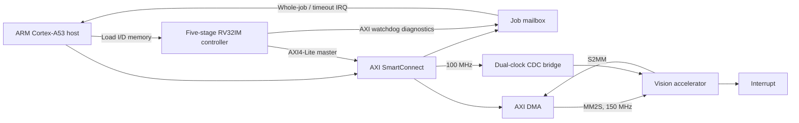

# Zynq Ultra96 AI Vision Accelerator

[](https://github.com/michaelgirg/zynq-ultra96-ai-vision-accelerator/actions/workflows/ci.yml)

Reusable FPGA image-preprocessing IP for 28x28 grayscale AXI4-Stream frames,
implemented and verified as a Zynq UltraScale+ production design.

## Architecture



The design supports four selectable modes:

| Mode | Operation | Output |
| ---: | --- | --- |
| 0 | Binary threshold | One 8-bit value per pixel |
| 1 | Sobel magnitude | One 8-bit value per pixel |
| 2 | Learned signed-INT8 3x3 convolution | One 8-bit activation |
| 3 | Four learned signed-INT8 3x3 convolutions | Four packed 8-bit activations |

The production wrapper adds AXI4-Lite control, AXI DMA integration, diagnostics,
interrupt status, register-version discovery, and a dual-clock CDC bridge.

The [Ultra96 application](docs/ultra96_application.md) joins firmware boot,
runtime model programming, cache-safe DMA, prediction, recovery and benchmark
CSV. Its native functional backend is locally tested; its Vitis/A53 adapter is
cross-compiled. Native-model timings are not reported as FPGA performance.

A heterogeneous SoC configuration adds a five-stage RV32IM control processor
with private caches, uncached AXI4-Lite accelerator/DMA access, an ARM/RV32 job
mailbox, and host-loadable instruction/data memory. Questa tests execute the
complete controller flow against the real accelerator RTL and a behavioral DMA
model; see [`docs/rv32_soc_integration.md`](docs/rv32_soc_integration.md).
The [job diagnostics extension](docs/job_diagnostics.md) adds whole-job timing,
host interrupts, sticky first-fault records and safe AXI timeout quarantine.

## Accelerator-only production snapshot

| Item | Result |
| --- | --- |
| Target | Avnet Ultra96-V2, `xczu3eg-sbva484-1-i` |
| Clocks | 100 MHz control, 150.015 MHz stream/data |
| Timing | +1.951 ns setup WNS, +0.010 ns hold WHS, zero failing endpoints |
| Signoff checks | Zero CDC critical/warning, methodology, and DRC error/critical-warning findings |
| Utilization | 15.54% LUT, 9.64% registers, 2.78% BRAM, 12.50% DSP |
| Estimated power | 2.084 W |

## RV32 heterogeneous-SoC checkpoint

| Item | Routed result |
| --- | --- |
| Target and clocks | Ultra96-V2; 100 MHz control, 150.015 MHz stream/data |
| Timing | +2.047 ns setup WNS, +0.011 ns hold WHS, zero failing endpoints |
| Signoff checks | Zero CDC warning/critical, methodology, and DRC error/critical-warning findings |
| Utilization | 23.62% LUT, 15.51% registers, 17.59% BRAM, 13.61% DSP |
| RV32 local memory | 64 KiB IMEM + 64 KiB DMEM mapped to 32 RAMB36E2 blocks |
| Estimated power | 2.119 W |

Implementation tables describe preserved routed checkpoints. Current recovery,
operand-retention and mailbox/watchdog RTL require a fresh Vivado build;
the recorded timing/resource numbers are not signoff for those changes.

## Verification summary

- Python predictor: 6,272/6,272 packed outputs matched.
- Directed RTL: all four modes, backpressure, consecutive frames, and error paths pass.
- Scalable convolution: 1-, 2-, and 4-filter configurations pass.
- CDC stress: three asynchronous clock ratios, skewed AXI-Lite accesses,
  reset-abort recovery, response flushing, and IRQ crossing pass.
- UVM: 11 focused tests plus a 100-seed randomized predictor run pass with zero
  UVM errors/fatals, assertion failures, or simulator errors.
- RV32 SoC: 306 jobs across three clocks, 210 full frames and 164,640 exact
  output checks; real portal boot/mailbox/CDC, candidate coefficients, native C
  capture checks and next-job recovery.
  See the [end-to-end regression](docs/soc_end_to_end_verification.md).
- Targeted functional coverage: 100%.
- New SoC gate: 57/57 planned directed bins at each clock ratio, plus CPU
  stalled-operand assertions (separate from historical UVM coverage).
- [Executed AXI-master formal check](docs/bounded_formal.md): 32-step bounded
  safety pass, including timeout/quarantine; the harness detects intentional
  write-data and quarantine defects.

Licensed UVM/coverage results above are preserved baseline evidence. The current
version-expectation update is locally compiled; a licensed rerun is separate.

Run the local checks from the repository root:

```powershell
powershell -ExecutionPolicy Bypass -File .\scripts\run_local_rtl_regression.ps1
```

The script discovers Questa commands from `PATH`. If needed, pass
`-QuestaBin "<Questa-install>\win64"`; no workstation path is stored in the
repository. The compiled RV32 firmware suite is available through
`scripts/run_riscv_firmware_regression.ps1` when a bare-metal RISC-V GNU
toolchain is installed.

## Release artifacts

The [four-filter training and classifier guide](docs/vector_model_training.md)
records a validation-selected candidate with 98.37% clean MNIST accuracy using
quantized convolution features, compared with 97.03% for the baseline. It adds
augmentation/robustness evaluation and an ARM C classifier checked against
PyTorch on all 10,000 test images, with matching predictions and 100,000 logits
within tolerance. Candidate coefficients load through the existing vector
registers; frozen bundles bind the model, configuration, exports, and results.

The [Ultra96-V2 production release candidate](https://github.com/michaelgirg/zynq-ultra96-ai-vision-accelerator/releases/tag/ultra96-v2-rc1)
contains the bitstream, bitstream-inclusive XSA, and SHA256 manifest. Generated
Vivado/Vitis projects, simulator databases, logs, local machine settings, and
release binaries are excluded from the source tree.

The RV32 SoC build also emits `u96v2rv32_wrapper.bit` and
`ultra96_v2_rv32_ai_vision_soc.xsa`. The reference checkpoint hashes use only
portable artifact basenames and are tracked in
[`hardware/reports/ultra96_v2_rv32_soc_sha256.txt`](hardware/reports/ultra96_v2_rv32_soc_sha256.txt).

## Ultra96-V2 production flow

The V2 flow targets the Avnet Ultra96-V2 ZU3EG device with a 100 MHz control
clock and 150 MHz stream/data clock. It uses AMD/Xilinx XPM CDC primitives for
single-bit and bundled-data crossings and emits reproducible Vivado reports.

The Windows wrapper discovers a Vivado Store board installation automatically;
other installations can provide `-BoardRepo` or `ULTRA96_BOARD_REPO`. Tool and
board locations remain runtime parameters and are never embedded in generated
source. Packaged user IP uses the neutral `user.org:u96_ai_vision` namespace.

CI checks predictor outputs, generated-file/register-map consistency, firmware
reset-vector placement, SystemVerilog lint, and repository hygiene. Generated
projects, reports, logs, simulator databases, tool settings, binaries, and
absolute host paths remain outside source control.

The control/register definitions are documented in
[`docs/register_map.md`](docs/register_map.md). Final production evidence is
summarized in [`docs/production_v2_release_status.md`](docs/production_v2_release_status.md).
See [`docs/README.md`](docs/README.md) for the current design documents and
historical engineering snapshots.

## Repository layout

```text
rtl/        synthesizable SystemVerilog datapaths and CDC wrapper
tb/         directed self-checking RTL testbenches
verif/      assertions, BFMs, UVM environment, and coverage
generated/  compact deterministic models, headers, and test vectors
pytorch/    quantization and golden-model utilities
vivado/     packaging and Ultra96-V2 build Tcl
scripts/    local regression and predictor utilities
software/   ARM application plus freestanding RV32 controller firmware
docs/       current design contract and historical engineering evidence
```
